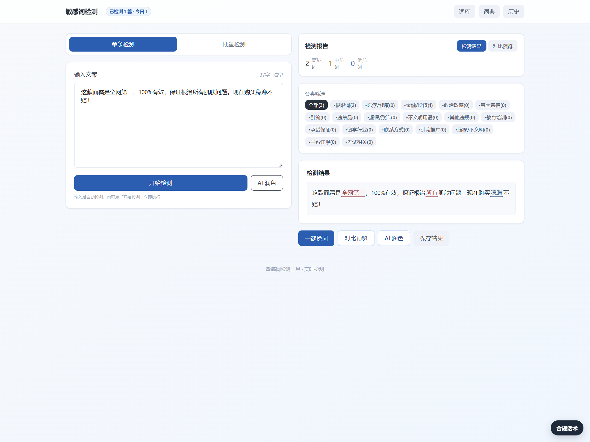

# 🛡️ 小红书违禁词检测工具

**让发布前的文案排查，变得更简单。**

纯前端单文件 · 基础检测纯本地 · 免登录 · 无需安装

<!-- 编辑位 1：在线体验链接；已填入当前 GitHub Pages 地址，可替换。 -->
### [🚀 在线体验](https://hehao0020.github.io/sensitive-check/) · [🐛 反馈问题](https://github.com/hehao0020/sensitive-check/issues) · [📄 产品需求与迭代记录](docs/PRD.md)

## ✨ 为什么做这个工具？

自媒体团队每天都要处理选题、文案和发布。逐字查找极限词、夸大宣传和敏感表述，既耗时，也容易遗漏。

本项目把**词库匹配 → 风险定位 → 替换建议 → 前后对比**放在一个页面中，帮助小红书创作者、运营人员和内容团队完成发布前的初步排查。

> ⏱️ **从人工排查约 20 分钟，到工具初筛约 10 秒。**  
> 这是项目方提供的业务场景效率参考，并非标准化性能测试；实际耗时取决于文案长度、设备和人工复核范围。

**本项目由独立开发者采用 Vibecoding 模式（AI辅助开发）完成，旨在用极简架构解决真实业务痛点。**

## 🖼️ 界面预览

<!-- 编辑位 2：截图位置；可替换为已获授权、已去除个人信息的群聊好评截图，或新的高清界面截图。 -->

*真实发布版界面，使用演示文案展示检测结果。*

## 🎯 核心功能

| 功能 | 用途 |
| --- | --- |
| 🔎 实时检测 | 粘贴文案自动初筛，也可点击「开始检测」 |
| 🏷️ 分类与高亮 | 按风险等级统计，通过分类筛选定位敏感表达 |
| 🔄 一键换词 | 查看建议，逐个替换或对当前范围全部替换 |
| 🪞 前后对比 | 对照原文与修改结果，复核后复制或使用新文案 |
| 📚 词库管理 | 查看词库，维护自定义词与白名单 |
| 📋 批量检测与历史 | 辅助多篇文案排查，在当前浏览器保留历史记录 |

### 词库覆盖范围

最初规划为 **17 类**；当前发布版已扩展至 **18 类**，新增「考试相关」。分类用于风险提示，不代表平台官方认定。

| 类别 | 类别 | 类别 |
| --- | --- | --- |
| 极限词 | 医疗 / 健康 | 金融 / 投资 |
| 政治敏感 | 夸大宣传 | 引流 |
| 违禁品 | 虚假 / 欺诈 | 不文明用语 |
| 其他违规 | 教育培训 | 承诺保证 |
| 留学行业 | 联系方式 | 引流推广 |
| 歧视 / 不文明 | 平台违规 | 考试相关 |

## 🚀 快速开始

### 方式一：在线使用

1. 打开 [在线体验页面](https://hehao0020.github.io/sensitive-check/)。
2. 粘贴文案，查看检测结果和风险分类。
3. 点击「一键换词」，选择「替换此词」或「全部替换」。
4. 在「对比预览」中复核语义，再复制修改后文案。

**基础检测无需注册、登录或配置 API Key。**

### 方式二：离线使用

1. 在仓库首页选择 **Code → Download ZIP**，解压文件。
2. 用现代浏览器打开根目录的 `index.html`。
3. 即可进行本地词库检测与替换，无需启动服务器。

单文件发布版已内嵌页面所需的 JavaScript、CSS 和词库，基础功能可离线运行。在线页面首次加载需要网络；可选 AI 功能需要联网。

## 🔒 文案隐私与数据边界

**默认词库检测与规则替换在浏览器本地完成，不需要上传文案。**

- 检测历史、自定义词、白名单等保存在当前浏览器的本地存储中。共享设备使用后，请按需清除站点数据。
- 无痕窗口的存储通常会在会话结束后清除；浏览器的具体行为可能不同。
- **可选「AI 润色」属于联网功能**：配置接口并主动调用后，文案会发送到该接口；默认接口为 DeepSeek。需要文案完全本地处理时，请仅使用基础检测和规则替换。
- 当前实现将用户配置的 API Key 保存在浏览器本地存储中，这不是加密保险箱。不要在共享设备保存密钥，也不要将密钥、密码、浏览器存储导出文件或含凭据的截图提交到仓库。

## 🧩 技术与部署

- **发布形式**：纯前端 HTML 单文件，无后端服务。
- **使用依赖**：现代浏览器；无需安装 npm 包。
- **源码技术**：Vue 3、TypeScript、Vite、Tailwind CSS；开发源码需要构建依赖。
- **部署方式**：GitHub Pages 或其他静态文件托管服务。

当前仓库主要存放可直接使用的发布产物；根目录 `index.html` 是入口。源码开发依赖与“用户使用零安装依赖”是不同概念。

## 🤝 反馈与贡献

欢迎通过 [Issues](https://github.com/hehao0020/sensitive-check/issues) 提交漏检、误报、替换建议或使用问题。

反馈时请提供**脱敏后的最小示例**、预期结果和浏览器版本。请勿提交客户未发布文案、个人信息或 API Key。

## 📮 联系开发者

<!-- 编辑位 3：填写希望公开的联系方式，不要放密码或 API Key。 -->
**我的联系方式：［待填写：邮箱 / 微信 / 个人主页］**

## 📌 使用说明

本工具提供基于内置词库的辅助初筛，并非小红书官方审核工具。词库可能存在遗漏或误报，替换建议也不保证语义准确或审核通过；发布前仍需结合上下文人工复核。

仓库当前未提供开源许可证文件；再分发、修改或商用前，请先与作者确认授权范围。
